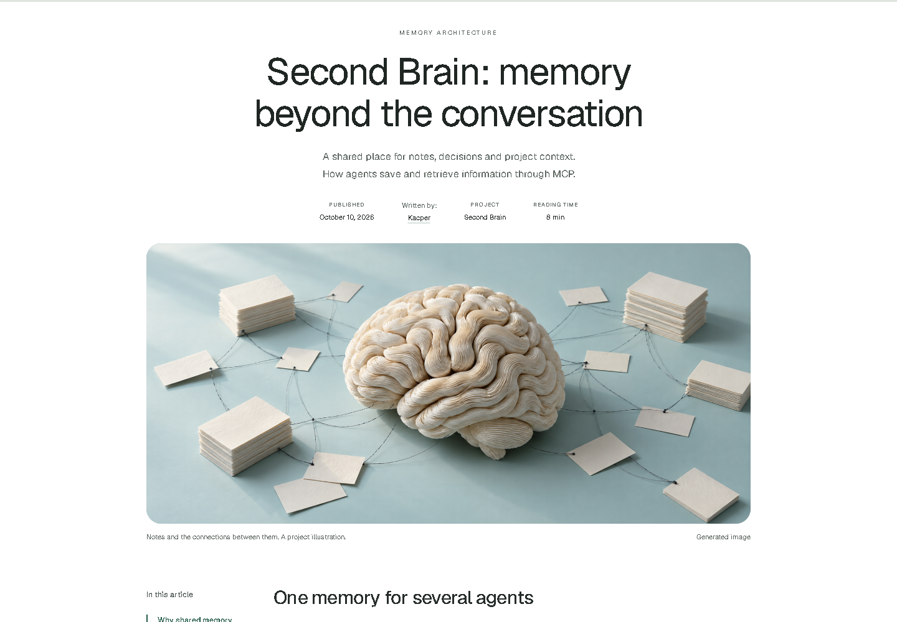

# Editorial Article

A portable agent skill for clear, interactive project articles in the approved editorial look.



White full-page layout, centered title, subject-specific cover, narrow reading column, optional step-through diagrams, glossary, relationship graphs and FAQ. Author profiles open in a hover panel. Thin reading-progress hairline at the top. English and Polish are separate offline pages.

## Install

```sh
npx skills@1.7.2 add SlafyGH/editorial-article-skill --skill editorial-article --agent codex claude-code --copy
```

Run inside the project; add `--global` for user-wide. Never put a token in a URL or prompt.

No installer? Copy `skills/editorial-article/` into `.agents/skills/` (Codex) or `.claude/skills/` (Claude Code), keep the whole folder, then refresh skill discovery.

## Use

```text
/editorial-article
Write a case study about this project for our site's "Realizacje" section.
```

The agent reads the repo, interviews you, writes the article, builds the try-it part from the project's code, makes a cover, embeds it in your site and asks before anything goes live. Self-contained; no other skills required. Image generation is optional.

## Renderer

Python 3.9+, no packages needed.

```sh
python3 skills/editorial-article/scripts/render_article.py --brief skills/editorial-article/assets/brief.example.json --out out/demo
python3 skills/editorial-article/scripts/check_article.py out/demo
```

Windows: use `py -3`. Helper refuses an existing output directory. The sample is fictional and image-free.

## Development checks

```sh
python3 -m unittest discover -s tests -v
npm ci && npx playwright install chromium && npm run test:browser
```

## License

Original work MIT; Geist OFL, Phosphor MIT, brand logos CC0. See THIRD_PARTY_NOTICES.md.
